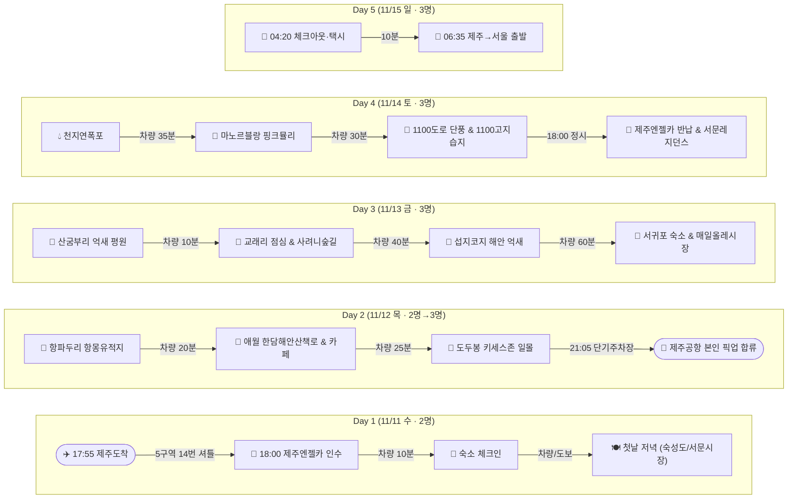

---
tags:
  - travel/dashboard
trip_id: "2026-11-Jeju"
destination: "제주도 (제주시·애월·조천·성산·서귀포·안덕)"
start_date: 2026-11-11
end_date: 2026-11-15
status: "항공·렌터카 예약완료"
---

# ✈️ 제주도 가족 여행 마스터 대시보드 (2026.11.11 ~ 11.15)

> [!abstract] 여행 개요
> - **일정:** `= this.start_date` ~ `= this.end_date` (4박 5일)
> - **인원:** 성인 가족 3명 (11/11 와이프·딸 선발대 → 11/12 21:05 본인 제주공항 합류)
> - **목적지:** `= this.destination` (`= this.trip_id`)
> - **상태:** `= this.status` (렌터카: [신한카드 제주엔젤카](https://shinhan.jejuangelcar.com/) 쏘나타 디엣지 서라운드뷰 25년 고급형 휘발유)

## 🗺️ 전체 지도 (Map View)

```mapview
{"name":"Jeju Family Travel Map","mapZoom":10,"centerLat":33.3846,"centerLng":126.5535,"query":"tag:#travel/place AND \"01_Travel/2026-11-Jeju\"","chosenMapSource":0,"autoFit":true,"showLinks":true,"linkColor":"blue","markerLabels":"on"}
```

## 🔀 일자별 이동 동선 (Mermaid)



## 📅 일자별 상세 일정 (Dataview)

### Day 1 (11/11 수)
```dataview
TABLE WITHOUT ID
  time AS "시간",
  file.link AS "장소",
  choice(category = "stay", "🏨 숙소",
    choice(category = "food", "🍽️ 식당",
    choice(category = "cafe", "☕ 카페",
    choice(category = "sight", "🏛️ 관광",
    choice(category = "shop", "🛍️ 쇼핑", "🚗 교통"))))) AS "분류",
  status AS "상태",
  memo AS "핵심 메모"
FROM #travel/place
WHERE trip_id = this.trip_id AND day = "Day 1"
SORT time ASC
```

### Day 2 (11/12 목)
```dataview
TABLE WITHOUT ID
  time AS "시간",
  file.link AS "장소",
  choice(category = "stay", "🏨 숙소",
    choice(category = "food", "🍽️ 식당",
    choice(category = "cafe", "☕ 카페",
    choice(category = "sight", "🏛️ 관광",
    choice(category = "shop", "🛍️ 쇼핑", "🚗 교통"))))) AS "분류",
  status AS "상태",
  memo AS "핵심 메모"
FROM #travel/place
WHERE trip_id = this.trip_id AND day = "Day 2"
SORT time ASC
```

### Day 3 (11/13 금)
```dataview
TABLE WITHOUT ID
  time AS "시간",
  file.link AS "장소",
  choice(category = "stay", "🏨 숙소",
    choice(category = "food", "🍽️ 식당",
    choice(category = "cafe", "☕ 카페",
    choice(category = "sight", "🏛️ 관광",
    choice(category = "shop", "🛍️ 쇼핑", "🚗 교통"))))) AS "분류",
  status AS "상태",
  memo AS "핵심 메모"
FROM #travel/place
WHERE trip_id = this.trip_id AND day = "Day 3"
SORT time ASC
```

### Day 4 (11/14 토)
```dataview
TABLE WITHOUT ID
  time AS "시간",
  file.link AS "장소",
  choice(category = "stay", "🏨 숙소",
    choice(category = "food", "🍽️ 식당",
    choice(category = "cafe", "☕ 카페",
    choice(category = "sight", "🏛️ 관광",
    choice(category = "shop", "🛍️ 쇼핑", "🚗 교통"))))) AS "분류",
  status AS "상태",
  memo AS "핵심 메모"
FROM #travel/place
WHERE trip_id = this.trip_id AND day = "Day 4"
SORT time ASC
```

## ✅ 여행 준비 및 체크리스트

- [x] 항공권 3인 예매 완료 (11/11 와이프·딸 16:40발 / 11/12 나 19:50발 / 11/15 전원 06:35발)
- [x] 신한카드 제주엔젤카 예약 완료 (쏘나타 디엣지 서라운드뷰 25년 고급형 휘발유, 11/11 18:00 ~ 11/14 18:00)
- [ ] 운전자 전원 운전면허증 실물 & 신분증 실물 지참 확인
- [ ] 11/11 렌터카 인수 시 본인(남편) 제2운전자 등록 방법 현장 확인
- [ ] 11/12 21:05 제주공항 단기주차장 픽업 위치 가족 공유
- [ ] 11/14 밤 짐 100% 패킹 및 11/15 새벽 04:20 체크아웃·택시 이동 준비
